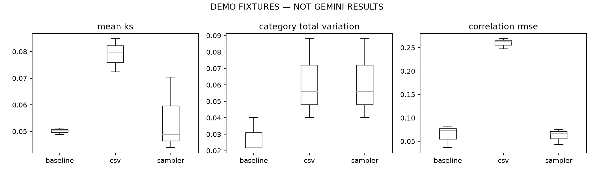

# DEMO FIXTURES — NOT GEMINI RESULTS

Lower is better for the metrics below. Baseline is an independent sample from the known generator.

```
 trial   method status  mean_ks  category_total_variation  correlation_rmse  real_xy_correlation  synthetic_xy_correlation  discriminator_oof_auc  discriminator_distance_from_chance  duplicate_fraction
     0 baseline     ok   0.0512                     0.022          0.037070             0.776744                  0.743810               0.493084                            0.006916                 0.0
     0      csv     ok   0.0796                     0.040          0.247419             0.776744                  0.005641               0.662284                            0.162284                 0.0
     0  sampler     ok   0.0440                     0.040          0.043331             0.776744                  0.798611               0.488808                            0.011192                 0.0
     1 baseline     ok   0.0504                     0.022          0.081158             0.801810                  0.817328               0.474856                            0.025144                 0.0
     1      csv     ok   0.0724                     0.088          0.262862             0.801810                 -0.005456               0.680276                            0.180276                 0.0
     1  sampler     ok   0.0488                     0.088          0.067141             0.801810                  0.795041               0.511276                            0.011276                 0.0
     2 baseline     ok   0.0488                     0.040          0.072715             0.778398                  0.755834               0.496836                            0.003164                 0.0
     2      csv     ok   0.0848                     0.056          0.268803             0.778398                 -0.015758               0.688976                            0.188976                 0.0
     2  sampler     ok   0.0704                     0.056          0.075434             0.778398                  0.816702               0.526296                            0.026296                 0.0
```

## Across-trial mean ± sample standard deviation

```
           mean_ks           category_total_variation           correlation_rmse           discriminator_distance_from_chance          
              mean       std                     mean       std             mean       std                               mean       std
method                                                                                                                                 
baseline  0.050133  0.001222                 0.028000  0.010392         0.063648  0.023401                           0.011741  0.011758
csv       0.078933  0.006227                 0.061333  0.024440         0.259695  0.011038                           0.177179  0.013613
sampler   0.054400  0.014063                 0.061333  0.024440         0.061969  0.016665                           0.016255  0.008696
```



KS p-values use Holm correction within each method/trial, not across the full experiment. A nonsignificant test is not proof of equality. Discriminator AUC uses pooled five-fold out-of-fold predictions; 0.5 is chance. This classifier cannot certify indistinguishability. Trial summaries are descriptive, not confidence intervals.