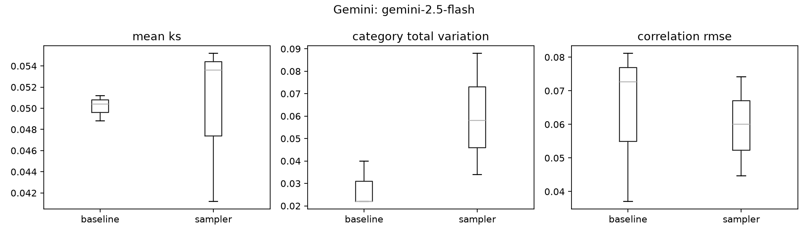

# Gemini: gemini-2.5-flash

Lower is better for the metrics below. Baseline is an independent sample from the known generator.

```
 trial   method status  mean_ks  category_total_variation  correlation_rmse  real_xy_correlation  synthetic_xy_correlation  discriminator_oof_auc  discriminator_distance_from_chance  duplicate_fraction                                                                           error
     0 baseline     ok   0.0512                     0.022          0.037070             0.776744                  0.743810               0.493084                            0.006916                 0.0                                                                             NaN
     0      csv failed      NaN                       NaN               NaN                  NaN                       NaN                    NaN                                 NaN                 NaN [Errno 2] No such file or directory: 'results/gemini/trial_0/csv/synthetic.csv'
     0  sampler     ok   0.0536                     0.034          0.060077             0.776744                  0.789235               0.503620                            0.003620                 0.0                                                                             NaN
     1 baseline     ok   0.0504                     0.022          0.081158             0.801810                  0.817328               0.474856                            0.025144                 0.0                                                                             NaN
     1      csv failed      NaN                       NaN               NaN                  NaN                       NaN                    NaN                                 NaN                 NaN [Errno 2] No such file or directory: 'results/gemini/trial_1/csv/synthetic.csv'
     1  sampler     ok   0.0412                     0.088          0.044632             0.801810                  0.802464               0.511248                            0.011248                 0.0                                                                             NaN
     2 baseline     ok   0.0488                     0.040          0.072715             0.778398                  0.755834               0.496836                            0.003164                 0.0                                                                             NaN
     2      csv failed      NaN                       NaN               NaN                  NaN                       NaN                    NaN                                 NaN                 NaN [Errno 2] No such file or directory: 'results/gemini/trial_2/csv/synthetic.csv'
     2  sampler     ok   0.0552                     0.058          0.074108             0.778398                  0.791059               0.523644                            0.023644                 0.0                                                                             NaN
```

## Across-trial mean ± sample standard deviation

```
           mean_ks           category_total_variation           correlation_rmse           discriminator_distance_from_chance          
              mean       std                     mean       std             mean       std                               mean       std
method                                                                                                                                 
baseline  0.050133  0.001222                    0.028  0.010392         0.063648  0.023401                           0.011741  0.011758
sampler   0.050000  0.007663                    0.060  0.027055         0.059606  0.014744                           0.012837  0.010106
```



KS p-values use Holm correction within each method/trial, not across the full experiment. A nonsignificant test is not proof of equality. Discriminator AUC uses pooled five-fold out-of-fold predictions; 0.5 is chance. This classifier cannot certify indistinguishability. Trial summaries are descriptive, not confidence intervals.